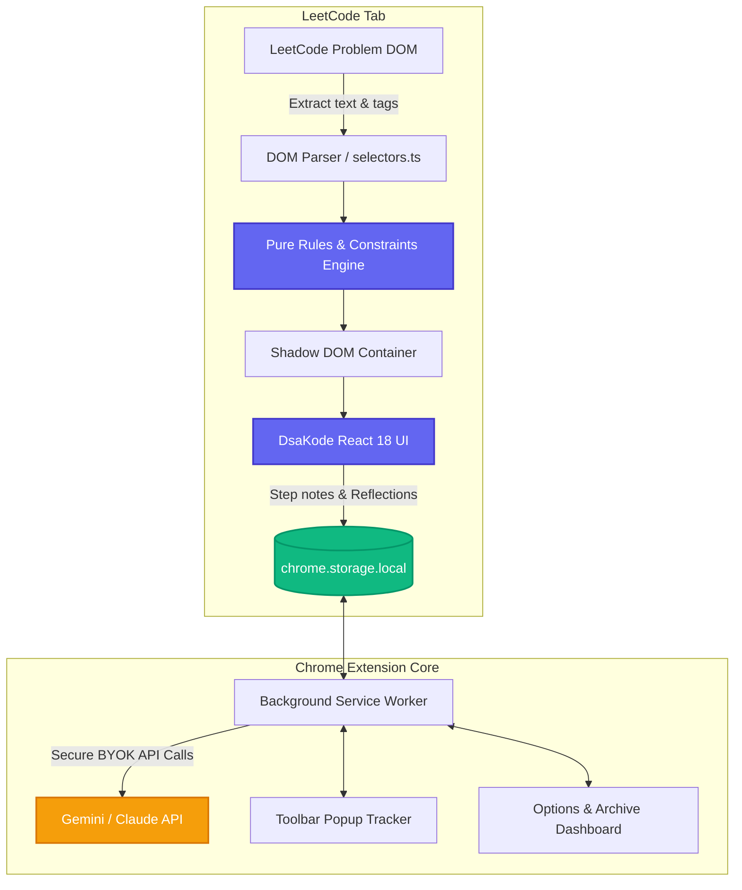

<div align="center">

  

  # 🧠 DsaKode
  ### **Think Logic. Crack Code.**
  
  **The Socratic LeetCode intuition coach Chrome Extension (Manifest V3)**  
  *Teaches you how to think, analyze constraints, detect bottlenecks, and pick the optimal data structure — without ever spoiling direct code or solutions.*

  <p align="center">
    <a href="https://github.com/Kali-Prem/DsaKode/stargazers"></a>
    <a href="https://github.com/Kali-Prem/DsaKode/blob/main/LICENSE"></a>
    <a href="https://developer.chrome.com/docs/extensions/mv3/"></a>
    <a href="https://www.typescriptlang.org/"></a>
    <a href="https://react.dev/"></a>
    <a href="https://vitejs.dev/"></a>
    <a href="https://vitest.dev/"></a>
    <a href="https://github.com/Kali-Prem"></a>
  </p>

  <p align="center">
    Grounded in Prem Kumar's <a href="https://github.com/Kali-Prem/dsa-logic-building-playbook"><strong>DSA Logic Building Playbook</strong></a>
  </p>

  <p align="center">
    <a href="#-quick-start--installation">Quick Start</a> •
    <a href="#-why-dsakode">Why DsaKode?</a> •
    <a href="#-core-features">Core Features</a> •
    <a href="#-how-it-works--architecture">Architecture</a> •
    <a href="#-keyboard-shortcuts">Shortcuts</a> •
    <a href="#-benchmark-test-matrix">Benchmarks</a> •
    <a href="#-creator--credits">Creator</a> •
    <a href="#-license">License</a>
  </p>

</div>

---

## 💡 Why DsaKode?

When preparing for Data Structures & Algorithms interviews on LeetCode, developers usually encounter two extremes:

1. **The Staring Trap**: Getting stuck on a blank editor for 45 minutes, feeling overwhelmed, and developing anxiety instead of intuition.
2. **The Tutorial Illusion**: Jumping straight to the discussion tab, YouTube walkthroughs, or AI code generators that spit out full code solutions. You understand the code in the moment, but blank out when faced with a variation in a real interview.

> [!IMPORTANT]
> **Real algorithmic mastery is not about memorizing code templates — it is about recognizing waste and choosing the right tool.**  
> **DsaKode** embeds directly inside LeetCode as an unobtrusive, zero-layout-shift companion that mentors you step-by-step through Socratic inquiry. It enforces a strict **Zero-Code Guarantee**: you do the thinking, you write the code.

| Capability | Standard LeetCode | Generative AI Copilots | 🧠 DsaKode |
| :--- | :---: | :---: | :---: |
| **Direct Code Spoilers** | None | ❌ Spits full solution code | 🛡️ **Zero Code Guarantee (Never spoils)** |
| **Socratic Thinking Ladder** | ❌ None | ❌ Inconsistent / hallucinated | ✅ **Structured 8-step playbook stepper** |
| **Complexity & TLE Gauge** | ❌ Only post-submission | ❌ Generic text | ⚡ **Real-time CPU ops vs $10^8$ threshold** |
| **Constraint Warnings** | ❌ Hidden in text | ⚠️ Often overlooked | 🚨 **Auto-flags negative numbers, overflows, bounds** |
| **Bottleneck $\to$ Tool Mapping**| ❌ Manual | ❌ Generic advice | 🎯 **9-Row Waste $\to$ Tool Prescription Matrix** |
| **Spaced Revision System** | ❌ Manual bookmarking | ❌ None | 🔁 **7-Day "Revise Karo" + 3-line reflections** |
| **LeetCode Integration** | Native | ❌ Separate tab or bulky UI | 🪟 **Shadow DOM (Zero CLS), dark/light sync** |

---

## 🌟 Core Features

### 🪜 1. Guided Ladder Mode (8-Step Socratic Stepper)
Breaks down any LeetCode problem into an interactive 8-step wizard so you never feel overwhelmed:

```
[1. Observe] ➔ [2. Manual Solve] ➔ [3. Naam Do] ➔ [4. Brute Force & TLE]
                                                            │
[8. Code Boundary] ⬅ [7. Dry Run Trace] ⬅ [6. Tool Chuno] ⬅ [5. Waste Dhoondo]
```

1. **Step 1: Observe** — Identifies output format ($N \to 1$ scalar, $N \to N$ linear, $N \to 2^N$ power set, or boolean), input sizes, and problem constraints.
2. **Step 2: Manual Solve** — Encourages pen-and-paper tracing on a concrete 4-element example before writing a single line of logic.
3. **Step 3: Naam Do** — Names the loops, state variables, pointers, and termination conditions to prevent chaotic mental state.
4. **Step 4: Brute Force & TLE** — Computes total worst-case operations (e.g. $N^2$ vs $10^8$ ops/sec CPU threshold) and issues explicit TLE warnings.
5. **Step 5: Waste Dhoondo** — Pinpoints redundant work (e.g., repeated linear scans, duplicate range sums, re-evaluating subproblems).
6. **Step 6: Tool Chuno** — Matches the discovered waste against the **9-Row Prescription Matrix** (e.g., repeated lookup $\to$ Hash Map; dynamic range query $\to$ Fenwick / Segment Tree).
7. **Step 7: Dry Run Trace** — Walks through boundary cases, empty collections, single-element inputs, and edge scenarios.
8. **Step 8: Code Boundary** — Formulates clean loop invariant guards and boundary checks before writing solution code in LeetCode's editor.

#### 🛡️ 3-Tier Spoiler-Free Progressive Hints
Each step provides progressive hints locked behind a **60-second soft cooldown timer**:
- **Level 1 (Nudge)**: A gentle Socratic question directing your attention to the bottleneck.
- **Level 2 (Pattern)**: The name of the algorithmic family or technique.
- **Level 3 (Why)**: The mathematical and logical explanation of why the technique works.

---

### 📊 2. Live Insights Dashboard

Stay ahead of constraints and bottlenecks before pressing **Submit**:

- **Complexity Meter**: Visual target spectrum ($O(1) \dots O(\log N) \dots O(N) \dots O(N \log N) \dots O(N^2) \dots O(2^N) \dots O(N!)$) calculated dynamically from input limits.
- **Operations & TLE Warning**: Bar gauge comparing worst-case operations to modern CPU execution limits ($10^8$ operations/second).
- **Constraints Analyzer & Badges**:
  - ⚠️ **Negative Numbers Allowed**: Warns when two-pointer or monotonic sliding-window assumptions fail.
  - 🚨 **64-bit Overflow Trap**: Warns about intermediate integer overflow (e.g., $10^9 \times 10^9$ requiring `long long` / `BigInt`).
  - 🛑 **Empty / Single Input Bounds**: Flags bounds like $N = 0$ or $N = 1$.
- **Keyword & Pattern Recognition Chips**: Decoupled rules engine matching 20+ algorithmic patterns (Prefix Sum, Monotonic Stack, Inward Pointers, Two-Headed Search, Binary Search on Answer Space, State-Space DFS/BFS, Dynamic Programming).
- **Waste $\to$ Tool Prescription Matrix**: 9 standard playbook rows where matched patterns glow in real-time.
- **Input-to-Output Growth Visualizer**: Demonstrates problem scale and state-space growth.
- **Edge Cases Checklist**: Curated checklist highlighting relevant checks and dimming irrelevant ones.

---

### 🤖 3. Optional Socratic AI Coach ("Ask Coach")

Want interactive conversational guidance while coding? DsaKode includes a dedicated, privacy-first AI companion:

- **Strict Zero-Code Guarantee**: Custom system prompt forbids generating syntax, code snippets, or full solutions. The AI guides in natural Socratic micro-steps (English or Hinglish).
- **Dual Provider Support**:
  - **Google Gemini**: Gemini 1.5 Flash, Gemini 1.5 Pro, Gemini 2.0 Flash.
  - **Anthropic Claude**: Claude 3.5 Sonnet, Claude 3.5 Haiku.
- **Bring Your Own Key (BYOK)**: Stored strictly in your browser's `chrome.storage.local`.
- **Sandboxed Security**: Content scripts running in the LeetCode tab **never touch your API key**. All API calls are executed securely in the background service worker (`background.js`).
- **Privacy-Preserving**: Only sends problem title, parsed constraints summary, Example 1, current step, and your notes. Full problem descriptions and your local editor code are never transmitted.

---

### 🔁 4. Spaced Revision & Reflections Archive

- **3-Line Playbook Reflection**: When marking a problem complete, record:
  1. *Core Pattern*
  2. *Trigger Observation*
  3. *Waste & Tool*
- **7-Day Spaced Repetition**: Solved problems automatically trigger a `"Revise Karo"` reminder badge 7 days later.
- **Quick Toolbar Popup**:
  - Live streak counter (🔥 active days).
  - Problems completed today.
  - One-click list of problems due for revision.
- **Full Options Dashboard (`chrome://extensions` Options)**:
  - Search and filter all solved problems and reflections.
  - One-click JSON backup **Export** & **Import**.
  - Reset and storage management.

---

### 🎨 5. Seamless LeetCode Integration & Accessibility

- **Zero Layout Shift (CLS = 0)**: Injected cleanly into an isolated **Shadow DOM** with fixed positioning. Never interferes with LeetCode's code editor, Monaco bindings, or layout containers.
- **Adaptive Theme Synchronization**: Automatically detects whether LeetCode is in **Dark** or **Light** mode and syncs panel styles instantly, with manual override support.
- **Dockable & Resizable**:
  - Dock to the **Right** or **Left** side of your screen.
  - Smoothly resize panel width between **380px** and **720px**.
  - Minimize to a sleek floating badge when you need full editor focus.
- **High-Contrast Accessibility**: Full ARIA roles (`role="progressbar"`, `role="tablist"`), focus rings, and screen-reader announcements.

---

## 🗺️ How It Works & Architecture



---

## ⌨️ Keyboard Shortcuts

| Shortcut | Action | Description |
| :--- | :--- | :--- |
| <kbd>Alt</kbd> + <kbd>C</kbd> *(or <kbd>Option</kbd> + <kbd>C</kbd>)* | **Toggle Panel** | Open or dismiss DsaKode side panel |
| <kbd>Esc</kbd> | **Close / Dismiss** | Safely close the active panel or hint drawer |
| <kbd>→</kbd> *(Arrow Right)* | **Next Step** | Advance to the next Thinking Ladder step |
| <kbd>←</kbd> *(Arrow Left)* | **Previous Step** | Return to the previous Thinking Ladder step |
| <kbd>Tab</kbd> / <kbd>Shift</kbd> + <kbd>Tab</kbd> | **Focus Navigation** | Accessible navigation through buttons, hints, and inputs |

---

## 🚀 Quick Start & Installation

### Option 1: Load Pre-Built Extension (Easiest)

1. Clone or download this repository:
   ```bash
   git clone https://github.com/Kali-Prem/DsaKode.git
   cd DsaKode
   ```
2. Build the production bundle:
   ```bash
   npm install
   npm run build
   ```
3. Open your browser's extension manager:
   - **Chrome**: `chrome://extensions/`
   - **Brave**: `brave://extensions/`
   - **Edge**: `edge://extensions/`
4. Toggle on **Developer mode** (top-right corner).
5. Click **Load unpacked** (top-left).
6. Select the **`dist`** folder inside the `DsaKode` directory.
7. Open any LeetCode problem (e.g. [Two Sum](https://leetcode.com/problems/two-sum/)).
8. Click the floating **DsaKode** icon on the bottom right or press <kbd>Alt</kbd> + <kbd>C</kbd> to launch!

---

### Option 2: Build & Package ZIP

To generate a distributable zip archive for Chrome Web Store or sharing:
```bash
npm run zip
```
This generates `extension.zip` in the root folder.

---

### Development Mode

For local development with hot reload:
```bash
# Watch content script, background, and UI builds
npm run dev
```

---

## 🧪 Benchmark Test Matrix

DsaKode is verified across 8 benchmark DSA patterns from the *DSA Logic Building Playbook*:

| # | Benchmark Problem | Detected Pattern | Target Complexity | Key Insight / Warning |
| :-: | :--- | :--- | :---: | :--- |
| 1 | **Two Sum** | Hash Map / Frequency Count | $O(N)$ | Repeated linear scan waste $\to$ lookup map |
| 2 | **Subarray Sum Equals K** | Prefix Sum + Hash Map | $O(N)$ | 🚨 Negative numbers alert: window invalid |
| 3 | **Container With Most Water** | Inward Two Pointers | $O(N)$ | Greedy elimination of shorter boundary |
| 4 | **Merge Intervals** | Sorting + Interval Sweep | $O(N \log N)$ | Coordinate order dependency |
| 5 | **Koko Eating Bananas** | Binary Search on Answer | $O(N \log(\max K))$ | Monotonic feasible space verification |
| 6 | **Coin Change** | Subproblem Memoization / DP | $O(N \times \text{amount})$ | Overlapping state transitions |
| 7 | **Number of Islands** | Grid BFS / DFS Flood Fill | $O(M \times N)$ | Visited in-place mutation vs set memory |
| 8 | **Subsets** | Backtracking State-Space Tree | $O(2^N)$ | Power-set branching complexity alert |

> Full manual verification procedure is documented in [`QA.md`](./QA.md).

---

## 🛠️ Extensibility & Customization

### Adding a New Keyword / Pattern Rule
All algorithmic detection patterns are fully decoupled in [`src/data/keywords.json`](./src/data/keywords.json).

To add a new rule (e.g., *Disjoint Set Union / Kruskal's*):
```json
{
  "id": "union-find",
  "patterns": ["connected components", "disjoint set", "redundant connection", "cycle in undirected graph"],
  "technique": "Union-Find (Disjoint Set Union)",
  "why": "Dynamic connectivity and cycle detection in undirected graphs run in nearly O(1) amortized time with path compression and union-by-rank.",
  "socraticQuestion": "Graph me dynamically edges add ho rahe hain aur cycle check karni hai ya components merge karne hain. DFS/BFS se baar-baar O(V+E) traversal karne ki jagah DSU se O(α(N)) me kaise karoge?",
  "wasteRow": 3,
  "confidence": "high"
}
```
Run `npm test` to verify your new rule against the engine!

### Centralized LeetCode DOM Selectors
If LeetCode updates their frontend layout, you only ever need to edit **one single file**: [`src/core/selectors.ts`](./src/core/selectors.ts). Fallbacks are gracefully handled.

---

## 📁 Repository Structure

```
DsaKode/
├── public/
│   ├── icons/                  # 16, 32, 48, 128, 512px & SVG logos
│   └── manifest.json           # Manifest V3 extension configuration
├── src/
│   ├── background/             # Service worker & AI BYOK secure proxy
│   │   ├── index.ts
│   │   └── prompt.ts           # Strict zero-code Socratic system prompt
│   ├── content/                # Content script injection & SPA navigation
│   │   ├── index.tsx           # Shadow DOM root & styles injection
│   │   └── navigation.ts       # History API & URL observer for LeetCode
│   ├── core/                   # Pure business logic & parsing engine
│   │   ├── constraints.ts      # Constraint parser & boundary detector
│   │   ├── engine.ts           # Keyword matcher & complexity calculator
│   │   ├── parser.ts           # LeetCode DOM extractor
│   │   ├── selectors.ts        # Resilient DOM selectors dictionary
│   │   ├── storage.ts          # Storage manager, streaks & migrations
│   │   └── types.ts            # Type definitions
│   ├── data/                   # Decoupled algorithmic rules
│   │   ├── complexityTiers.json
│   │   ├── edgeCases.json
│   │   ├── keywords.json       # 20+ algorithmic pattern rules
│   │   ├── thinkingLadder.json # 8-step wizard blueprints
│   │   └── wasteTool.json      # 9-row playbook prescription matrix
│   ├── options/                # Options page & reflections archive
│   ├── popup/                  # Extension popup & streak tracker
│   └── ui/                     # React 18 UI components
│       ├── App.tsx             # Main extension shell
│       ├── SidePanel.tsx       # Dockable, resizable sidebar
│       ├── FloatingButton.tsx  # Unobtrusive toggle trigger
│       ├── components/         # Design system (Badge, Button, Tabs, Card, etc.)
│       └── guided/             # Stepper, Insights, Hint Drawer, Ask Coach
├── tests/                      # 115 Vitest unit & integration tests
├── scripts/                    # Icon generation & zip distribution scripts
├── QA.md                       # Comprehensive QA & manual verification guide
├── package.json
├── tailwind.config.js
└── vite.config.ts              # Multi-bundle Vite build setup
```

---

## 🧪 Test Suite

DsaKode maintains a comprehensive test suite with **115 passing tests** across 12 test suites:

```bash
# Run test suite
npm test

# Run with interactive watch mode
npm run test:watch

# Run with test coverage
npm run test:coverage
```

```
 Test Files  12 passed (12)
      Tests  115 passed (115)
   Coverage  High coverage across engine, parser, constraints, and UI
```

---

## 👨‍💻 Creator & Credits

<div align="center">
  <h3>Created with passion by <strong>Prem Kumar</strong> (<a href="https://github.com/Kali-Prem">@Kali-Prem</a>)</h3>

  <p>
    <a href="https://github.com/Kali-Prem"></a>
    <a href="https://github.com/Kali-Prem/dsa-logic-building-playbook"></a>
    <a href="https://github.com/Kali-Prem/DsaKode"></a>
  </p>
</div>

- **Architect & Developer**: **Prem Kumar** ([@Kali-Prem](https://github.com/Kali-Prem))
- **Methodology**: Inspired by and built on Prem's **[DSA Logic Building Playbook](https://github.com/Kali-Prem/dsa-logic-building-playbook)**, a structured framework designed to help software engineers transition from blind rote memorization to first-principles algorithmic intuition.
- **Contributions**: Contributions, bug reports, and feature suggestions are warmly welcomed! Please feel free to open an issue or submit a pull request.

---

## 🤝 Contributing

1. Fork the Project (`https://github.com/Kali-Prem/DsaKode/fork`).
2. Create your Feature Branch (`git checkout -b feature/AmazingFeature`).
3. Commit your Changes (`git commit -m 'Add some AmazingFeature'`).
4. Push to the Branch (`git push origin feature/AmazingFeature`).
5. Open a Pull Request.

---

## 📄 License

Distributed under the **MIT License**. See [`LICENSE`](./LICENSE) for full details.

---

<div align="center">
  <sub>Built for thinkers, problem solvers, and future software architects. If DsaKode helped you crack a problem, consider giving it a ⭐ on <a href="https://github.com/Kali-Prem/DsaKode">GitHub</a>!</sub>
</div>
